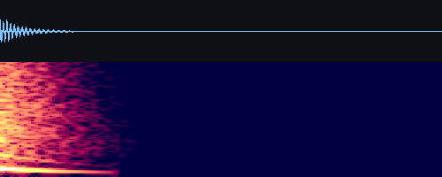
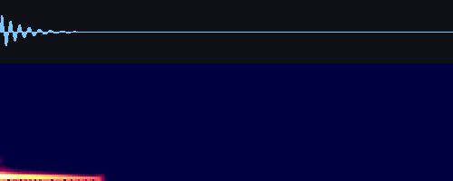
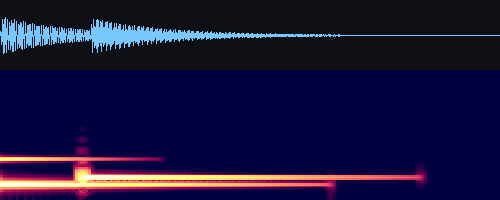
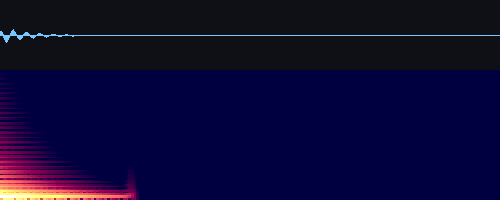
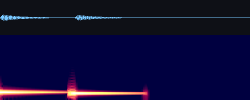
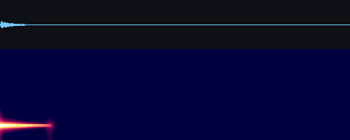
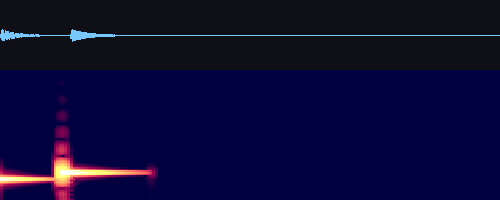
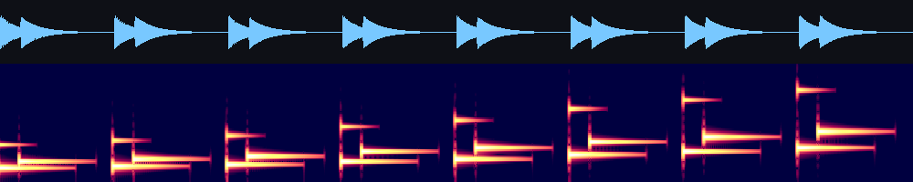

# Flickline audio

Implements design section 12 (sound) for the feedback sound set, issue #20. Every sound is synthesised from code at load: no samples, no downloads, no network requests. Recipes are data in `src/config/audio.ts`; the renderer is `src/audio/dsp.ts` + `src/audio/cues.ts`; the engine is `src/audio/audioEngine.ts`; events are wired in one place, `src/audio/sfx.ts`.

## How it works

**Rendering.** `renderSoundSet()` turns each recipe (tone and filtered-noise layers, exponential envelopes) into a mono `Float32Array`, normalised to the cue's peak target, once, when the audio context is created on the first user gesture (the Play click). The arrays are copied into `AudioBuffer`s. The synthesis is plain TypeScript rather than an `OfflineAudioContext` so the exact buffers the game plays are rendered and measured in Vitest (Node has no Web Audio); that is what makes the peak and spectrum tests run in CI. Rendering is synchronous and seeded, so output is deterministic. Measured: 29 buffers, 3.8 s of audio; 26 to 40 ms warm and 70 to 150 ms worst cold in headless Chromium on a heavily loaded shared machine (load average 60+ on 8 cores); the unit test asserts < 150 ms.

**Graph.**

```
voice (BufferSource -> Gain -> [HRTF Panner]) -> bus.volume -> bus.duck -> master gain -> soft limiter -> destination
buses: weapons, hits, enemies, ui
```

* Bus volumes and the master volume come from settings (`volume`, `weaponsVolume`, `hitsVolume`, `enemiesVolume`, `uiVolume`, each 0..1) and are applied on `settingsChanged`.
* **Ducking:** every hit, kill and sparkle cue dips the `weapons` bus by 3 dB for 80 ms (2 ms attack, 40 ms linear release). Verified on the real graph: shot alone -15.14 dBFS, shot with a hit playing (hits bus muted so only the ducked weapon is measured) -18.14 dBFS.
* **Limiter:** a static soft limiter (WaveShaper): identity up to -3 dBFS, tanh shoulder above, never exceeds -0.01 dBFS. It adds no latency. The first attempt used a `DynamicsCompressorNode`; in Chromium it delays the signal by about 6 ms and attenuated short transients by 13 to 16 dB, so it was replaced. Everything-at-once pile-up (8 cues) peaks at -1.6 dBFS.
* **Positional voices:** `play(cue, { position })` routes the voice through an HRTF `PannerNode` (inverse distance model). The listener pose is set once per frame from the player's head (`setListener`, skipped when unchanged). Only the miss cue is positional today (at the impact point); enemy cues (#41) will use the same path.
* **No per-frame cost:** nothing is rendered or allocated per frame. A `play()` creates one source and one gain node (plus a panner for positional voices); the debug play log is a preallocated ring.
* **Voice limit:** 24. Beyond that, low-priority cues are dropped; headshot, kill and streak-break are never dropped.

## API

```ts
engine.play(cueId, { pitchStep?, position?, gain? })
```

* `pitchStep` is the kill ladder step (the clean streak), clamped to 1..8, so the ladder caps at step 8. Only `kill` and `killSparkle` use it.
* `position` is a world position in metres (HRTF voice). `gain` is an extra linear gain.
* Shot cues (`shotPace`, `shotKestrel`) get +/-3% random pitch (playback rate) and +/-3% gain per shot from a seeded audio-side generator (never the sim RNG, so determinism is untouched).
* Before the first user gesture the context does not exist and `play()` is a no-op.

## Event wiring (`attachSfx`)

| Event | Cue |
|---|---|
| `shotFired` | weapon shot by `weapon` id (`pace` -> `shotPace`, `kestrel` -> `shotKestrel`, anything else or absent -> Kestrel); plus `movingShot` when `moving` is true |
| `shotImpact` with `onTarget: false` | `miss` at the impact point (positional) |
| `targetHit` | `hitBody` (zone `body` or absent), `hitLeg` (`leg`), `hitHead` (`head`) |
| `targetKilled` | `kill` at ladder step = current clean streak (min 1, cap 8); `killSparkle` at the same step when `zone` is `head` |
| `streakUpdated` | tracks the streak; a streak of 2 or more falling to 0 plays `streakBreak` |

`streakUpdated { streak, mult }` is a typed contract in `src/feedback/events.ts` (design 14.3); its producer lands with the run/feedback work (#13, #40). The producer must emit it before presentation handles the `targetKilled` it belongs to; subscribing the producer to the bus before `attachSfx` does that. `shotFired.weapon`, `shotFired.moving` and the `zone` fields are optional additions to the sim event types until the weapon and enemy work (#14, #15) emits them; absent means default weapon, not moving, body.

UI ticks: `src/audio/uiSounds.ts` plays `uiTick` for a click on any menu button and `uiConfirm` for the primary Play button (one delegated listener).

## Mix targets (peak dBFS of the rendered cue at unity bus gain)

Design section 12: hits peak around -12 dBFS, weapons around -15 dBFS. Levels for cues the design describes only in words are noted as chosen.

| Cue | Target | Rationale |
|---|---|---|
| shots | -15 | design |
| body thock, headshot, kill chime | -12 | design |
| leg thock | -18 | design: 6 dB quieter than the body thock |
| kill sparkle | -18 | chosen: a top layer under the chime |
| miss pfft | -26 | design: "low gain" |
| moving-shot tock | -20 | chosen: audible under the shot, clearly lower than a hit |
| streak break | -22 | design: "quiet" |
| UI ticks | -24 / -22 | chosen: soft, never near hit levels |
| jump / land / footstep | -30 / -24 / -32 | scaffold placeholders carried over; #41 replaces them |

A unit test renders the set and checks every cue (every ladder step) is within 1 dB of its target.

## The cues

Each image: waveform on top, spectrogram (0 to 8 kHz, 250 ms wide) below. Regenerate with `npm run audio:snapshot` (writes `docs/audio/*.png` and prints the metrics table).

| Cue | Description | Metrics |
|---|---|---|
| `shotPace` | Pace: high and dry. 2 ms high-passed noise transient, a 520 -> 210 Hz triangle body over 70 ms, and a short band-passed noise tail sweeping 3.6 -> 2.2 kHz. 82 ms. |  |
| `shotKestrel` | Kestrel: mid and punchy. 2 ms transient, a 230 -> 84 Hz sine body (110 ms) with a 460 -> 170 Hz triangle snap, and a low-passed noise tail. 152 ms. |  |
| `hitBody` | Thock: 60 ms sine drop 220 -> 110 Hz with a 3 ms low-passed click. Nothing above about 1 kHz. |  |
| `hitLeg` | The same thock a semitone lower and 6 dB quieter. |  |
| `hitHead` | The thock plus the tink: two detuned triangles at 1.90 kHz and 1.92 kHz, 120 ms. The bright line in the spectrogram is the tink; it is the only cue with strong energy at 1.9 kHz. |  |
| `kill` | Chime on a pentatonic ladder: a sine note, then a rising fifth 45 ms later, with a faint bell partial. 8 steps from 880 Hz (A5) at semitones 0, 2, 4, 7, 9, 12, 14, 16. See the ladder image below. |  |
| `killSparkle` | Headshot-kill top layer: detuned triangles an octave above the step note and a short fifth, 135 ms. |  |
| `miss` | 20 ms band-passed noise "pfft" sweeping 2.3 -> 1.4 kHz, quiet, positional at the impact point. |  |
| `movingShot` | Flat, low, dull "tock": 150 Hz triangle, 70 ms, a soft click, no pitch movement and no ladder. |  |
| `streakBreak` | Falling minor third (880 -> 740 Hz), 2 x 75 ms sines, soft. |  |
| `uiTick` | 40 ms, 1.2 kHz sine tick. |  |
| `uiConfirm` | Two ticks, 1.2 then 1.6 kHz, 80 ms. |  |
| `jump`, `land`, `footstep` | Low-passed noise puffs carried over from the scaffold. #41 owns the real set. |    |

The kill ladder, steps 1 to 8 (250 ms apart), 0 to 8 kHz:



Measured (48 kHz):

| cue | bus | length | peak | centroid | dominant | energy > 1.5 kHz |
|---|---|---|---|---|---|---|
| `shotPace` | weapons | 82 ms | -15.0 dBFS | 920 Hz | 398 Hz | 11.0 % |
| `shotKestrel` | weapons | 152 ms | -15.0 dBFS | 270 Hz | 164 Hz | 3.4 % |
| `hitBody` | hits | 60 ms | -12.0 dBFS | 177 Hz | 176 Hz | 0.0 % |
| `hitLeg` | hits | 60 ms | -18.0 dBFS | 167 Hz | 164 Hz | 0.0 % |
| `hitHead` | hits | 120 ms | -12.0 dBFS | 1802 Hz | 1922 Hz | 89.8 % |
| `kill` (step 1) | hits | 215 ms | -12.0 dBFS | 1257 Hz | 1318 Hz | 0.1 % |
| `killSparkle` (step 1) | hits | 135 ms | -18.0 dBFS | 2575 Hz | 2643 Hz | 100.0 % |
| `miss` | hits | 20 ms | -26.0 dBFS | 3842 Hz | 1805 Hz | 88.2 % |
| `movingShot` | hits | 70 ms | -20.0 dBFS | 156 Hz | 152 Hz | 0.0 % |
| `streakBreak` | hits | 150 ms | -22.0 dBFS | 744 Hz | 738 Hz | 0.0 % |
| `uiTick` | ui | 40 ms | -24.0 dBFS | 1200 Hz | 1195 Hz | 0.0 % |
| `uiConfirm` | ui | 80 ms | -22.0 dBFS | 1597 Hz | 1605 Hz | 95.4 % |

**Headshot vs body, by spectrum (the centroid test):** the body thock has 0.0% of its energy above 1.5 kHz and a centroid of 177 Hz; the headshot has 89.8% above 1.5 kHz and a centroid of 1802 Hz (10x). The unit test requires the thock under 3% and the tink over 20% above 1.5 kHz, the headshot centroid at least twice the thock's, and the dominant frequencies on opposite sides of 1.5 kHz and 400 Hz. By ear the difference is a dull knock against a bright "ting" on top of the same knock.

## Deviations and decisions

* **Sample-domain synthesis instead of `OfflineAudioContext`** (issue text): see "Rendering"; same intent (rendered once at load, no network), testable in CI.
* **Soft-limiter waveshaper instead of a compressor** as the master limiter: see "Graph".
* **Design 12 vs cue research (`docs/cue-design.md`, #52):** the issue names design 12 for behaviour, so hits follow it (low thock, 1.9 kHz tink). The research doc proposes tonal 1.8 kHz body ticks and a 3.3 kHz headshot ping; a different balance, left for a tuning pass after play-testing. Cue-design's body-hit throttling (skip body sounds within 40 ms) and moving-shot throttling are not in design 12 and are not implemented; per-shot cues play every shot.
* **Chain chime layer, enemy tells, damage, near miss, footsteps, medal fanfare** are out of scope (#40, #41).
* **Miss "surface type"** is not varied: the sim does not emit a surface type yet (map tags arrive with #16).
