# Flickline audio

Implements design section 12 (sound): the feedback sound set (issue #20) and the rest of the set (issue #41: weapons, enemy tells, damage, near miss, footsteps, chain, medal, Surge, run flow). Every sound is synthesised from code at load: no samples, no downloads, no network requests. Recipes are data in `src/config/audio.ts`; the renderer is `src/audio/dsp.ts` + `src/audio/cues.ts`; the engine is `src/audio/audioEngine.ts`; events are wired in one place, `src/audio/sfx.ts`.

## How it works

**Rendering.** `renderSoundSet()` turns each recipe (tone and filtered-noise layers, exponential envelopes) into a mono `Float32Array`, normalised to the cue's peak target, once, when the audio context is created on the first user gesture (the Play click). The arrays are copied into `AudioBuffer`s. The synthesis is plain TypeScript rather than an `OfflineAudioContext` so the exact buffers the game plays are rendered and measured in Vitest (Node has no Web Audio); that is what makes the peak and spectrum tests run in CI. Rendering is synchronous and seeded, so output is deterministic. Measured: 54 buffers, 8.7 s of audio, no network requests (the #20 set was 29 buffers and 3.3 s; #41 added the rest of design 12; see "Measurements on the real graph" for the current timings). Render time in headless Chromium (software GL, a shared machine at a load average of 60 to 70 on 8 cores, so every number is inflated by roughly 8x contention): best of 12 renders 12.7 ms, typical warm 16 to 30 ms, first call at page load 50 to 200 ms depending on what else was running. The unit test asserts < 150 ms for a warm render in Node. The engine records its own render time (`__flickline.audio().stats.renderMs`).

**Graph.**

```
voice (BufferSource -> Gain -> [HRTF Panner]) -> bus.volume -> bus.duck -> master gain -> soft limiter -> destination
buses: weapons, hits, enemies, ui
```

* Bus volumes and the master volume come from settings (`volume`, `weaponsVolume`, `hitsVolume`, `enemiesVolume`, `uiVolume`, each 0..1) and are applied on `settingsChanged`.
* **Ducking:** every body, leg and head hit and every kill dips the `weapons` bus for 80 ms (then a 40 ms linear release), instantly, because the shot that came with the hit starts on the same sample. The depth keeps the weapons bus 6.5 dB under the cue that ducks it and never less than the design's 3 dB (`duckDepthDb`): 3.5 dB under a body thock, headshot or kill (-12 dBFS), 9.5 dB under the quieter leg thock (-18). The 0.5 dB over the 6 dB target covers the shots' +/-3% gain variation. A deeper duck that is still holding wins. (#20 ducked a flat 3 dB; see Deviations.)
* **Limiter:** a static soft limiter (WaveShaper): identity up to -3 dBFS, tanh shoulder above, never exceeds -0.01 dBFS. It adds no latency. The first attempt used a `DynamicsCompressorNode`; in Chromium it delays the signal by about 6 ms and attenuated short transients by 13 to 16 dB, so it was replaced. Everything-at-once pile-up (8 cues) peaks at -1.6 dBFS.
* **Positional voices:** `play(cue, { position })` routes the voice through an HRTF `PannerNode` (inverse distance model; a cue may carry its own `spatial` distance model). The listener pose is set once per frame from the player's head (`setListener`, skipped when unchanged). Positional cues: the miss (at the impact point), the enemy tell, enemy shot and enemy footsteps (at the enemy), and the near-miss whiz (at the bullet's closest approach to the head).
* **Master low-pass dip:** taking damage dips a low-pass on the master (`dipLowpass`, wired by `damageAudio.ts`): the cutoff falls from open (20 kHz) to 900 Hz in 8 ms with a linear ramp and returns over the rest of 300 ms with an exponential ramp (exponential in frequency, so it is even in pitch). Every change is a ramp; nothing steps.
* **Loops:** `setLoop(cue, on)` runs a seamless looping cue (the Surge shimmer) with a 120 ms fade in and out.
* **Staggering:** `play(cue, { delayMs })` starts a voice later on the audio clock (the chain layers, and scripted scenarios).
* **No per-frame cost:** nothing is rendered or allocated per frame. A `play()` creates one source and one gain node (plus a panner for positional voices); the debug play log is a preallocated ring.
* **Voice limit:** 24. Beyond that, low-priority cues are dropped; headshot, kill, chain, streak-break, enemy tell, whiz, damage thud, medal and the results fanfare are never dropped (recipes flag `priority`).

## API

```ts
engine.play(cueId, { pitchStep?, position?, gain? })
```

* `pitchStep` is the kill ladder step (the clean streak), clamped to 1..8, so the ladder caps at step 8. Only `kill` and `killSparkle` use it.
* `position` is a world position in metres (HRTF voice). `gain` is an extra linear gain.
* Cues flagged `jitter` (the four weapon shots, own and enemy footsteps, the enemy shot) get +/-3% random pitch (playback rate) and +/-3% gain per play from a seeded audio-side generator (never the sim RNG, so determinism is untouched).
* `durationMs` (`enemyTell` only) is the tell's length; `delayMs` starts the voice that many ms later.
* Before the first user gesture the context does not exist and `play()` is a no-op.

## Event wiring

`attachSfx` (player side), `attachEnemySfx` (enemies and damage; positions come from the `AudioWorld` interface that `features/audio.ts` implements over the target registry), `attachDamageAudio` (the low-pass dip), `EnemyFootsteps` (ticked per sim tick) and the UI-click listener are set up by `features/audio.ts`.

| Event | Cue |
|---|---|
| `shotFired` | weapon shot by `weapon` id (`pace` -> `shotPace`, `kestrel` -> `shotKestrel`, `rill` -> `shotRill`, `longnail` -> `shotLongnail`, anything else or absent -> Kestrel); plus `movingShot` when `moving` is true |
| `shotImpact` with `onTarget: false` | `miss` at the impact point (positional) |
| `targetHit` | `hitBody` (zone `body`), `hitLeg` (`leg`), `hitHead` (`head`) |
| `targetKilled` | `kill` at ladder step = current clean streak (min 1, cap 8); `killSparkle` at the same step when `zone` is `head`; then, when the chain is 2 or more, `chain` layers (below) |
| `chainUpdated` | tracks the chain count (the layers play with the kill that follows) |
| `streakUpdated` | tracks the streak; a streak of 2 or more falling to 0 plays `streakBreak` |
| `reloadStarted` / `reloadCompleted` | `reloadOut` / `reloadIn` (a cancelled reload makes no second sound) |
| `weaponSwitched` | `equip` |
| `playerJumped` / `playerLanded` / `footstep` | `jump` / `land` (gain by impact speed) / `footstep` (not while walking, 0.4x gain crouched) |
| `enemyTell { id, durationMs }` | `enemyTell` at the enemy, exactly `durationMs` long |
| `enemyFired { id, hit, dir }` | `enemyShot` at the enemy; on a miss also `whiz` where the bullet line passes the head |
| `playerDamaged` | `damageThud` (centred, not positional) and the master low-pass dip |
| enemy motion | `enemyFootstep` at the enemy, one per 2.2 m walked, within 30 m (derived from target motion per sim tick: the sim has no enemy step event) |
| `runReady` / `runStarted` | `uiReady` blip / `uiGo` chirp |
| `runEnded` | `resultsFanfare` for `timer` and `complete`, `runEnd` (the closing root note) for `death` and `quit`; also stops the Surge loop |
| `surgeStarted` / `surgeEnded` | `surgeWhoosh` + the `surgeShimmer` loop / loop fade-out (a restart or run end also stops it) |
| `medalAwarded` | `medal` |

**Contract note (`enemyFired.dir`):** the whiz needs where the missed bullet passed, so `dir` is read as the world-space unit direction the bullet travelled from the enemy's muzzle (the shot's own direction, including its miss deviation). The closest approach of that line to the player's eye (if it is ahead of the muzzle and within `whiz.maxMissM`, 3 m) is where the whiz plays, so HRTF puts it on the side it passed.

`streakUpdated { streak, mult }` is a typed contract in `src/feedback/events.ts` (design 14.3); its producer lands with the run/feedback work (#13, #40). The producer must emit it before presentation handles the `targetKilled` it belongs to; subscribing the producer to the bus before `attachSfx` does that. `shotFired.moving` and the `zone` of `targetHit`/`targetKilled` are emitted by the sim; `shotFired.weapon` is an optional addition until the weapon work (#14) sets it; absent means the default weapon (Kestrel).

UI ticks: `src/audio/uiSounds.ts` plays `uiTick` for a click on any menu button and `uiConfirm` for the primary Play button (one delegated listener).

## Mix targets (peak dBFS of the rendered cue at unity bus gain)

Design section 12: hits peak around -12 dBFS, weapons around -15 dBFS. Levels for cues the design describes only in words are noted as chosen.

| Cue | Target | Rationale |
|---|---|---|
| shots | -15 | design |
| body thock, headshot, kill chime | -12 | design |
| leg thock | -18 | design: 6 dB quieter than the body thock |
| kill sparkle | -18 | chosen: a top layer under the chime |
| miss pfft | -26 | design: "low gain" |
| moving-shot tock | -20 | chosen: audible under the shot, clearly lower than a hit |
| streak break | -22 | design: "quiet" |
| UI ticks | -24 / -22 | chosen: soft, never near hit levels |
| Rill, Longnail shots | -15 | design (weapons) |
| enemy shot | -15 | chosen: weapon level on the enemies bus (distance-attenuated at play time) |
| enemy tell | -14 | chosen: 2 dB under a hit so a tell never masks a hit; a tell is also louder as it ends and attenuates gently with distance |
| whiz | -20 | chosen: brief, bright, below a hit |
| damage thud | -12 | chosen: priority, as loud as a hit (it is the cost of one) |
| chain layer | -17 | chosen: a layer under the -12 kill chime |
| medal | -17 | chosen |
| reload / equip | -24 / -22 / -24 | chosen: small mechanical sounds under the shots |
| jump / land / footstep / enemy footstep | -30 / -24 / -32 / -26 | chosen: information, not ambience |
| Surge whoosh / shimmer | -20 / -34 | chosen: the shimmer is a bed under everything |
| ready / go / run end / fanfare | -22 / -21 / -22 / -16 | chosen |

A unit test renders the set and checks every cue (every ladder step) is within 1 dB of its target.

## The cues

Each image: waveform on top, spectrogram (0 to 8 kHz, 250 ms wide) below. Regenerate with `npm run audio:snapshot` (writes `docs/audio/*.png` and prints the metrics table).

| Cue | Description | Metrics |
|---|---|---|
| `shotPace` | Pace: high and dry. 2 ms high-passed noise transient, a 520 -> 210 Hz triangle body over 70 ms, and a short band-passed noise tail sweeping 3.6 -> 2.2 kHz. 82 ms. |  |
| `shotKestrel` | Kestrel: mid and punchy. 2 ms transient, a 230 -> 84 Hz sine body (110 ms) with a 460 -> 170 Hz triangle snap, and a low-passed noise tail. 152 ms. | 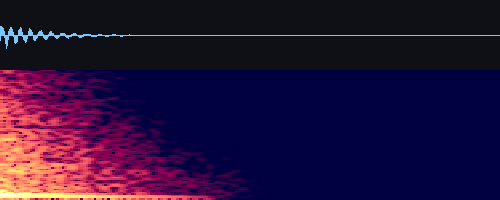 |
| `hitBody` | Thock: 60 ms sine drop 260 -> 150 Hz with its second harmonic (520 -> 300 Hz) at -6 dB, and a 3 ms 3 kHz click (a sine burst) peaking about -20 dBFS (research #52 R2/R3). The click is the short blip at 3 kHz in the spectrogram. |  |
| `hitLeg` | Weaker than the body in three ways at once (#52 R1): the thock 3 semitones lower (219 -> 126 Hz), 6 dB quieter, 35 ms instead of 60, and no click. | 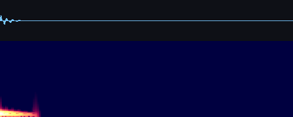 |
| `hitHead` | The thock plus the tink: two detuned triangles at 3.00 kHz and 3.03 kHz, 120 ms (#52 R4). The bright line in the spectrogram is the tink, far above the kill ladder's top step (1.1 kHz). | 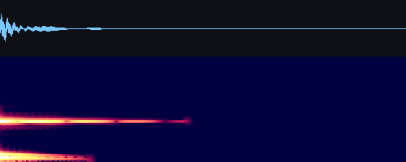 |
| `kill` | Chime on a pentatonic ladder: a 200 ms sine note with a slightly detuned twin (x1.005) for a bell-like shimmer. 8 steps from 440 Hz (A4) at semitones 0, 2, 4, 7, 9, 12, 14, 16, so the top step is 1109 Hz, far below the 3 kHz tink. See the ladder image below. |  |
| `killSparkle` | Headshot-kill top layer: two detuned triangles an octave above the step note, 90 ms. | 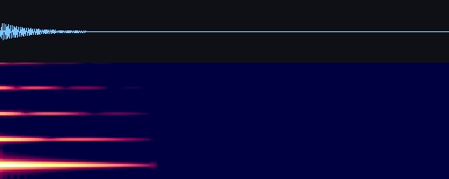 |
| `miss` | 20 ms band-passed noise "pfft" sweeping 2.3 -> 1.4 kHz, quiet, positional at the impact point. | 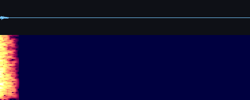 |
| `movingShot` | Flat, low, dull "tock": 150 Hz triangle, 70 ms, a soft click, no pitch movement and no ladder. |  |
| `streakBreak` | Falling minor third (880 -> 740 Hz), 2 x 75 ms sines, soft. |  |
| `uiTick` | 40 ms, 1.2 kHz sine tick. |  |
| `uiConfirm` | Two ticks, 1.2 then 1.6 kHz, 80 ms. |  |
| `jump`, `land`, `footstep` | Jump: a 900 Hz low-passed scuff over a 120 -> 80 Hz push. Land: a 110 -> 55 Hz thump over a 600 Hz low-passed puff. Footstep: a 14 ms band-passed click at 1.4 kHz over a 95 -> 60 Hz thump, quiet, with +/-3% jitter. | 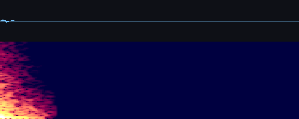 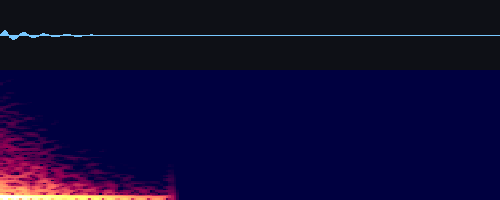 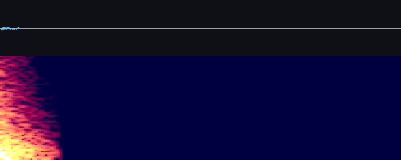 |
| `shotRill` | Rill: tight and fast. 2 ms high-passed transient, a 400 -> 180 Hz triangle body over 45 ms, a short band-passed tail 3.0 -> 1.8 kHz. 57 ms, shorter than Pace. | 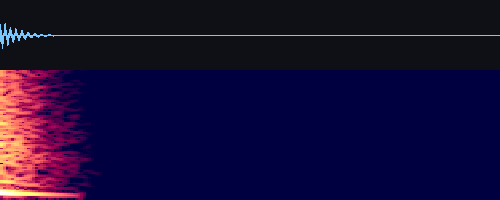 |
| `shotLongnail` | Longnail: deep with a long tail. 3 ms transient, a 150 -> 45 Hz sine body over 220 ms, a 300 -> 90 Hz triangle snap, and a low-passed noise tail sweeping 1.8 kHz -> 250 Hz over 520 ms. 523 ms. | 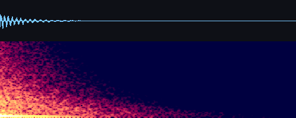 |
| `enemyShot` | An enemy's shot, on the enemies bus and positioned: a 300 -> 110 Hz triangle body and a low-passed tail (1.5 kHz -> 450 Hz). Duller than every player shot (its centroid differs from each by more than 10%, tested) so it is never mistaken for your own fire. | 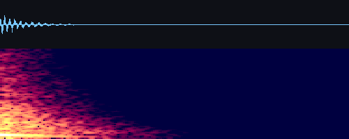 |
| `reloadOut`, `reloadIn`, `equip` | Mag out: a high-passed click, a short 900 -> 500 Hz tick and a second clack 35 ms later. Mag in: a 180 -> 120 Hz seat thump with two clicks (2.2 and 3.0 kHz). Equip: a 900 Hz -> 3.2 kHz band-passed slide ending in a click. All under -20 dBFS. | 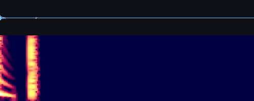 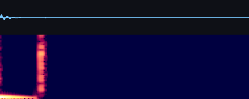 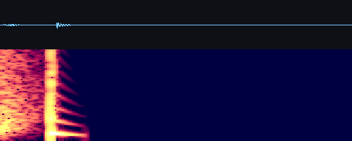 |
| `enemyTell` | See "The enemy tell" below. | 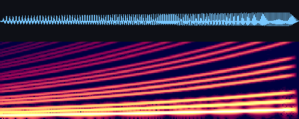 |
| `whiz` | Near miss: 100 ms band-passed noise (Q 3) falling 3.2 -> 1.1 kHz with a 2.2 -> 0.9 kHz sine, soft attack. Positioned at the bullet's closest approach. | 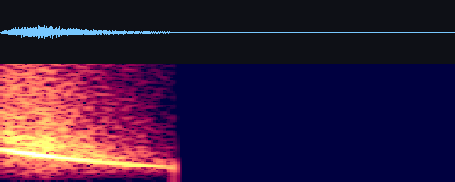 |
| `damageThud` | 150 ms sine drop 95 -> 42 Hz with a low-passed click and a 180 -> 70 Hz body. Nothing above 1 kHz, lower and 2.5x longer than the body thock (tested), centred in the head. | 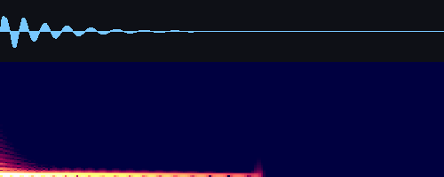 |
| `enemyFootstep` | The footstep family with a heavier click (1.8 kHz) and thump (85 -> 50 Hz), on the enemies bus, positioned. | 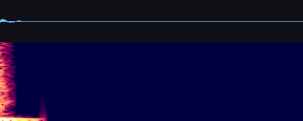 |
| `chain` | Layered a fifth above the kill note: two detuned sines, 140 ms, 8 variants (one per ladder step). For the top steps the fifth would land above 1.4 kHz, in the headshot tink's band, so it is folded down an octave. Chain of 2 plays one layer, 3 two, 4 or more three (gains 1, 0.8, 0.65, 55 ms apart). See the chain ladder image below. | 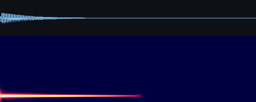 |
| `medal` | Four notes C5 E5 G5 C6, 100 ms apart, 400 ms: a triangle with a sine an octave up (brighter than the kill chime's sines). | 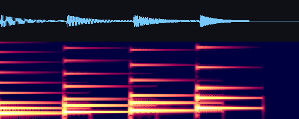 |
| `surgeWhoosh`, `surgeShimmer` | Whoosh: band-passed noise sweeping 250 Hz -> 5 kHz with a rising sine, a 330 ms attack in 450 ms. Shimmer: a seamless 1 s loop of sines at 880, 884, 1320, 1327 Hz (whole cycles per second; they beat at 4 and 7 Hz), very quiet. | 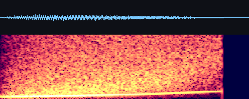 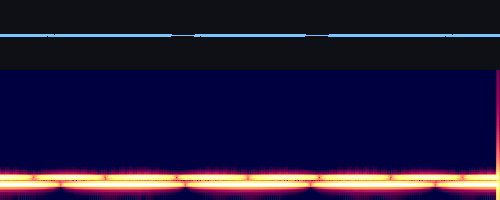 |
| `uiReady`, `uiGo` | Ready: one 880 Hz blip, 70 ms. Go: an 880 -> 1480 Hz chirp, 120 ms (0.8 s later, at run start). | 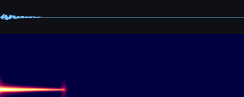 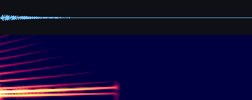 |
| `resultsFanfare`, `runEnd` | Fanfare: E5, C#5, then A4 (440 Hz, the ladder root) held 320 ms with the octave below: falling home. Run end (death, quit): the root note alone, 200 ms. | 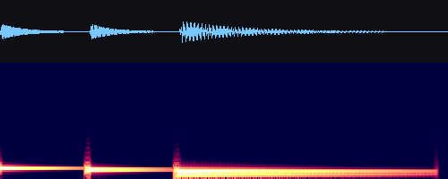 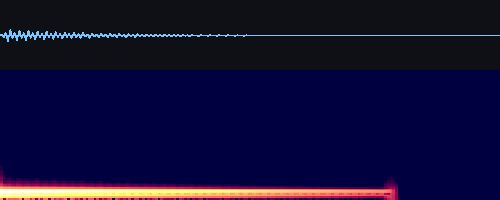 |

The kill ladder, steps 1 to 8 (250 ms apart), 0 to 8 kHz:


The chain layer for the same eight steps (a fifth above each kill note, folded under the tink at the top):

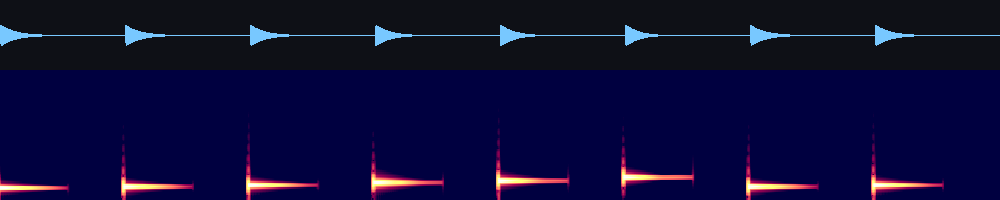

Measured (48 kHz, `npm run audio:snapshot`):

| cue | bus | length | peak | centroid | dominant | energy > 1.5 kHz |
|---|---|---|---|---|---|---|
| `shotPace` | weapons | 82 ms | -15.0 dBFS | 920 Hz | 398 Hz | 11.0 % |
| `shotKestrel` | weapons | 152 ms | -15.0 dBFS | 270 Hz | 164 Hz | 3.4 % |
| `hitBody` | hits | 60 ms | -12.0 dBFS | 263 Hz | 211 Hz | 0.0 % |
| `hitLeg` | hits | 35 ms | -18.0 dBFS | 221 Hz | 176 Hz | 0.0 % |
| `hitHead` | hits | 120 ms | -12.0 dBFS | 2830 Hz | 3000 Hz | 89.2 % |
| `kill` (step 1) | hits | 200 ms | -12.0 dBFS | 441 Hz | 439 Hz | 0.0 % |
| `killSparkle` (step 1) | hits | 90 ms | -18.0 dBFS | 897 Hz | 885 Hz | 0.6 % |
| `miss` | hits | 20 ms | -26.0 dBFS | 3842 Hz | 1805 Hz | 88.2 % |
| `movingShot` | hits | 70 ms | -20.0 dBFS | 156 Hz | 152 Hz | 0.0 % |
| `streakBreak` | hits | 150 ms | -22.0 dBFS | 744 Hz | 738 Hz | 0.0 % |
| `uiTick` | ui | 40 ms | -24.0 dBFS | 1200 Hz | 1195 Hz | 0.0 % |
| `uiConfirm` | ui | 80 ms | -22.0 dBFS | 1597 Hz | 1605 Hz | 95.4 % |
| `jump` | weapons | 50 ms | -30.0 dBFS | 223 Hz | 94 Hz | 1.4 % |
| `land` | weapons | 90 ms | -24.0 dBFS | 91 Hz | 82 Hz | 0.0 % |
| `footstep` | weapons | 35 ms | -32.0 dBFS | 89 Hz | 82 Hz | 0.2 % |
| `shotRill` | weapons | 57 ms | -15.0 dBFS | 706 Hz | 305 Hz | 9.3 % |
| `shotLongnail` | weapons | 523 ms | -15.0 dBFS | 305 Hz | 97 Hz | 3.2 % |
| `reloadOut` | weapons | 41 ms | -24.0 dBFS | 1464 Hz | 703 Hz | 17.5 % |
| `reloadIn` | weapons | 50 ms | -22.0 dBFS | 159 Hz | 152 Hz | 0.1 % |
| `equip` | weapons | 65 ms | -24.0 dBFS | 1438 Hz | 539 Hz | 31.3 % |
| `enemyShot` | enemies | 143 ms | -15.0 dBFS | 444 Hz | 229 Hz | 3.7 % |
| `enemyTell` | enemies | 300 ms | -14.0 dBFS | 605 Hz | 521 Hz | 1.1 % |
| `whiz` | enemies | 100 ms | -20.0 dBFS | 1703 Hz | 1676 Hz | 69.1 % |
| `damageThud` | enemies | 150 ms | -12.0 dBFS | 74 Hz | 70 Hz | 0.0 % |
| `enemyFootstep` | enemies | 40 ms | -26.0 dBFS | 85 Hz | 70 Hz | 0.4 % |
| `chain` (step 1) | hits | 140 ms | -17.0 dBFS | 661 Hz | 662 Hz | 0.0 % |
| `medal` | ui | 400 ms | -17.0 dBFS | 911 Hz | 784 Hz | 12.2 % |
| `surgeWhoosh` | ui | 450 ms | -20.0 dBFS | 863 Hz | 340 Hz | 12.6 % |
| `surgeShimmer` | ui | 1000 ms | -34.0 dBFS | 999 Hz | 884 Hz | 0.0 % |
| `uiReady` | ui | 70 ms | -22.0 dBFS | 880 Hz | 879 Hz | 0.0 % |
| `uiGo` | ui | 120 ms | -21.0 dBFS | 1000 Hz | 1025 Hz | 0.1 % |
| `resultsFanfare` | ui | 540 ms | -16.0 dBFS | 405 Hz | 439 Hz | 0.0 % |
| `runEnd` | ui | 200 ms | -22.0 dBFS | 410 Hz | 439 Hz | 0.0 % |

**Headshot vs body, by spectrum (the centroid test):** the body thock has 0.0% of its energy above 1.5 kHz (its 3 ms click is loud in level, about -20 dBFS, but tiny in energy) and a centroid of 263 Hz; the headshot has 89.2% above 1.5 kHz and a centroid of 2830 Hz (10x). The unit test requires the thock under 3% and the tink over 20% above 1.5 kHz, the headshot centroid at least twice the thock's, the tink dominant above 2.5 kHz and the thock's below 400 Hz. By ear the difference is a knock with a tick on it against a bright "ting" on top of the same knock.

**Cue research #52 R1-R4 (adopted in #130), each with a test in `soundSet.test.ts`:** R1 leg vs body: 3 semitones lower (dominant 211 vs 176 Hz), 6 dB quieter, 35 vs 60 ms, no click (the leg has nothing in the 2.5-4 kHz band). The research's "ERB separation >= 1.5" cannot come from the fundamental alone at this pitch (3 semitones near 200 Hz is about 0.7 ERB); the separation is in the click band, where the body has the click and the leg has none. R2: about a fifth of the body thock's energy is above 250 Hz (it was about 0 at 220 -> 110 Hz). R3: the click peaks at about -21 dBFS in the 2.5-4 kHz band, at least 10 dB over every player weapon's peak there once the body hit's weapon duck (`duckDepthDb`, 3.5 dB) applies. Before the duck the margins are Pace 9.2 dB (its noise tail is the closest), Rill 11.6, Kestrel 13.4, Longnail 16.7. The weapons' pitched bodies were not moved below 200 Hz: the click alone meets the check, and the shot sounds are a feel decision (#62). R4: thock, kill ladder (440-1109 Hz) and tink (3 kHz) are at least 3 ERB apart.

## The enemy tell

Design 5.3 and 12: a rising tone at the enemy's position for as long as the tell lasts, so the player hears where the threat is and how long they have. The length is the event's `durationMs` (0.5 s down to a 0.15 s floor, set by the dial), so it is not one fixed buffer: `audio/tell.ts` renders it per length, exactly `round(durationMs * sampleRate / 1000)` samples (a few hundred microseconds), and the engine caches the `AudioBuffer` per whole millisecond (the dial moves only at beat boundaries, so a run touches a handful of lengths; cap 64).

Shape: a triangle at the swept pitch plus an octave partial at 0.3 (a saw-like edge), an exponential sweep 300 -> 900 Hz (even steps in musical pitch), a level growing from 0.55 to 1 over the tell (urgency), a 6 ms fade in and 10 ms fade out inside the length so it never clicks, peak -14 dBFS. Played through an HRTF panner at the enemy's head/muzzle (1.3 m above its feet) with a gentler distance model than other cues (reference 3 m, roll-off 0.6) so a distant tell is still audible. Images: 150, 300, 500 ms.

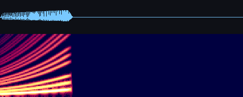 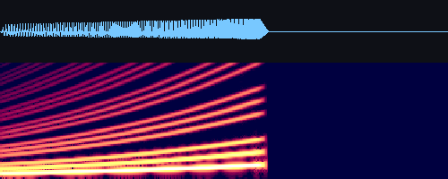 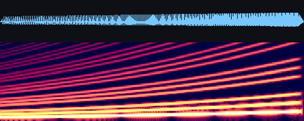

Tested in Vitest on the exact buffers: length to the sample, and the audible length (first to last sample above 1% of the peak) within 5 ms for 150 to 500 ms including fractional lengths; pitch rising evenly from 300 to 900 Hz; silent first and last samples and no step between samples; louder at the end than the start.

## Measurements on the real graph

Node has no Web Audio, so the checks that need the browser's HRTF panner and graph run in headless Chromium through the debug hook: `await __flickline.audioProbe('spatial' | 'dip' | 'mix' | 'synth')` (`audio/probe.ts`, loaded on demand). They render the actual `AudioEngine`, buses, ducking, limiter and event wiring on an `OfflineAudioContext`; nothing is played. Numbers from the PR that added them (headless Chromium, software GL, a machine at a load average of about 60 on 8 cores):

**Direction (HRTF), left/right energy.** Listener at the origin facing -Z, source at +/-60 degrees, 8 m away (the whiz 1 m). Right minus left, dB:

| cue | -60 deg | +60 deg |
|---|---|---|
| `enemyTell` (300 ms) | -4.9 | +5.0 |
| `enemyShot` | -2.7 | +2.8 |
| `whiz` | -12.6 | +12.9 |

The sign always follows the side, so direction is identifiable; the pure bearing maths is also unit-tested (`spatial.ts`).

**Damage dip.** A steady 4 kHz tone through the real master chain, rendered with and without a dip: the level falls by 23.4 dB within 10 ms of the dip and is back within 1 dB after 125 ms (the cutoff is exponential in frequency, so a 4 kHz tone returns after about 150 ms and only the very top of the spectrum is cut for the full 300 ms; the cutoff itself is back to open at 300 ms). The largest sample-to-sample step of the dipped signal is 1.23x the steady tone's own over the whole dip and 1.19x in the 20 ms around its start and end, against about 1.9x or more that a gain jump would add: ramps, no clicks.

**Mix, busiest Sweep moment.** `mixScenario.ts` scripts it (the bot harness, #28, does not exist yet): a Kestrel spray at 11 rounds/s for 2.6 s, hitting 5 of 6 bullets (body, head and leg) with a kill every third hit (so a chain and a streak build), moving shots, three enemies telling (300, 250, 180 ms) and each firing a hit and a near miss, three damage thuds, own and enemy footsteps, a Surge and a medal. Each bus is rendered alone and compared in the 40 ms starting at each of the 25 hits (peak of the hits bus over peak of the other bus, dB; minimum / median):

| hits over | body | head | leg | all |
|---|---|---|---|---|
| weapons | 6.3 / 9.5 | 6.5 / 7.6 | 9.1 / 11.7 | 6.3 / 9.1 |
| enemies | | | | 9.8 / 35.2 |
| ui | | | | 6.7 / 23.9 |

So the hits bus is at least 6 dB above the weapons bus at every hit. Before the depth rule (a flat 3 dB duck) the minimum was 2.6 dB: the leg thock is 6 dB quieter than the body thock by design, so a flat 3 dB duck left it level with the weapons. The whole mix peaks at -12.9 dBFS, far from the limiter.

**Synthesis time at load.** 54 buffers, 8.7 s of audio. Vitest (Node): cold first render 117 ms, warm 28 ms. Headless Chromium, first call after page load on the loaded machine: 180 ms, then 32 to 78 ms; the live engine in the game measured 76 ms. All under the 300 ms bar.

## Deviations and decisions

* **Sample-domain synthesis instead of `OfflineAudioContext`** (issue text): see "Rendering"; same intent (rendered once at load, no network), testable in CI.
* **Soft-limiter waveshaper instead of a compressor** as the master limiter: see "Graph".
* **Design 12 vs cue research (#52):** design 12 adopted R1-R4 in #130 (see "The cues" above). The research's body-hit throttling (skip body sounds within 40 ms) and moving-shot throttling are not in design 12 and are not implemented; per-shot cues play every shot.
* **Ladder root 440 Hz, not 880 Hz.** The merged cue research (`docs/research/cues.md` 3.4) found that a root above about 760 Hz puts the top ladder step above the old 1.9 kHz tink, so a high kill would sound like a headshot. The ladder spans 440 to 1109 Hz and a test keeps every step below 1.5 kHz; since #130 the tink is at 3 kHz (R4), well clear of it.
* **Hit-over-weapons duck depth (#41).** Design 12 says hits duck weapons by 3 dB for 80 ms. With weapons at -15 and the body thock at -12 that gives 6 dB, but the leg thock is -18, which a flat 3 dB duck leaves level with the weapons, and #41 requires the hits bus to be at least 6 dB above the weapons bus at every hit. The depth is therefore derived (`duckDepthDb`): the design's 3 dB as the floor, deeper under quieter hit cues (3.5 dB for the body thock, headshot and kill, 9.5 dB for the leg thock). The shots dip only for 80 ms and only on hits; the sparkle no longer ducks on its own (it rides a kill, which does).
* **Enemy tell volume (#41).** -14 dBFS, 2 dB under a hit, so it can never mask one. Design gives no number.
* **No bot harness yet (#41).** The mix check replays a scripted busiest-moment event stream through the real wiring; swap in the bot harness (#28) when it lands.
* **Left/right test runs in Chromium (#41).** The acceptance criterion asks for a headless left/right energy test; the HRTF panner exists only in the browser, so it runs in headless Chromium via `audioProbe('spatial')` and the bearing maths is unit-tested in Vitest.
* **Enemy footsteps are derived (#41).** The sim has no enemy step event, so `EnemyFootsteps` counts the distance each enemy walks per sim tick (a stride of 2.2 m, like the player's).
* **Vane has no sound of its own.** Design 12 describes Pace, Kestrel, Rill and Longnail; an unknown weapon id plays the Kestrel shot until Vane's character is designed.
* **Own footsteps and counter-strafing.** Design 12 says own footsteps are quiet clicks "while not counter-strafing"; the sim's `footstep` event only says walking or not, so own steps sound whenever the sim emits them and the player is not holding walk.
* **Chain layer count.** One extra chime for a chain of 2, two for 3, three for 4 or more (design 12: one per chain step, capped by `chain.gains`).
* **Miss "surface type"** is not varied: the sim does not emit a surface type yet (map tags arrive with #16).
