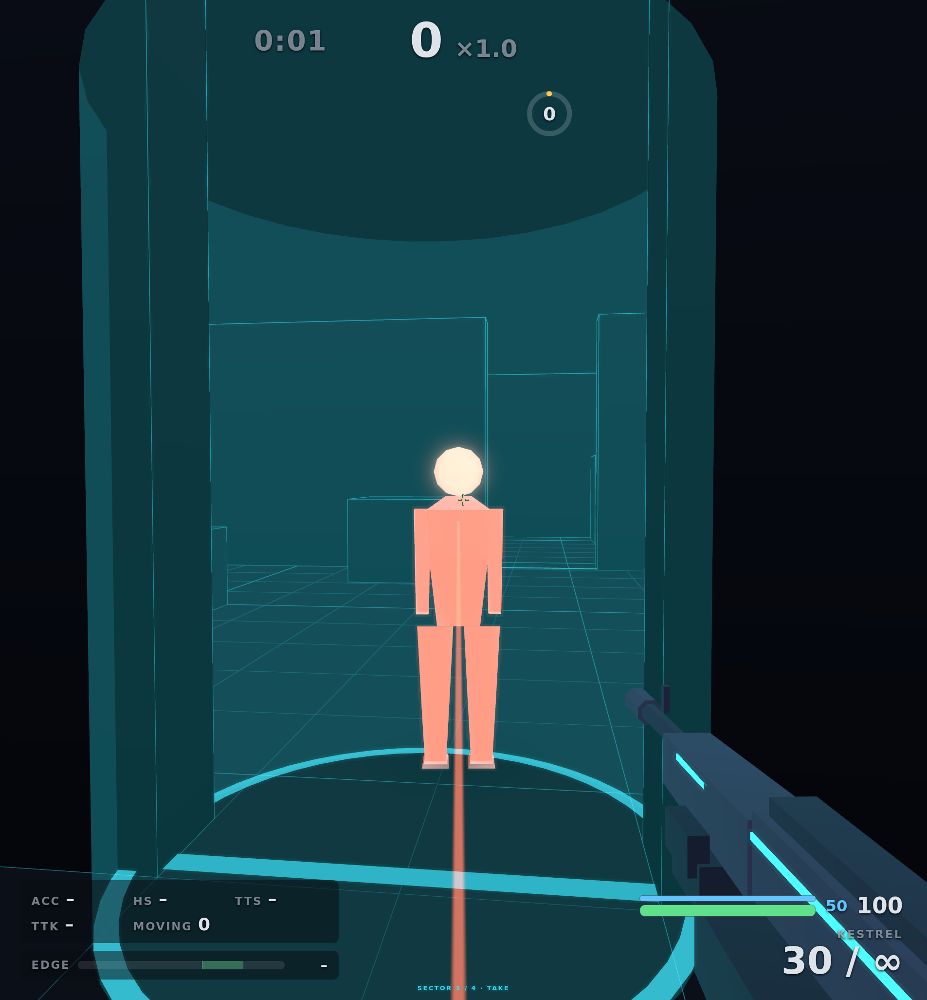
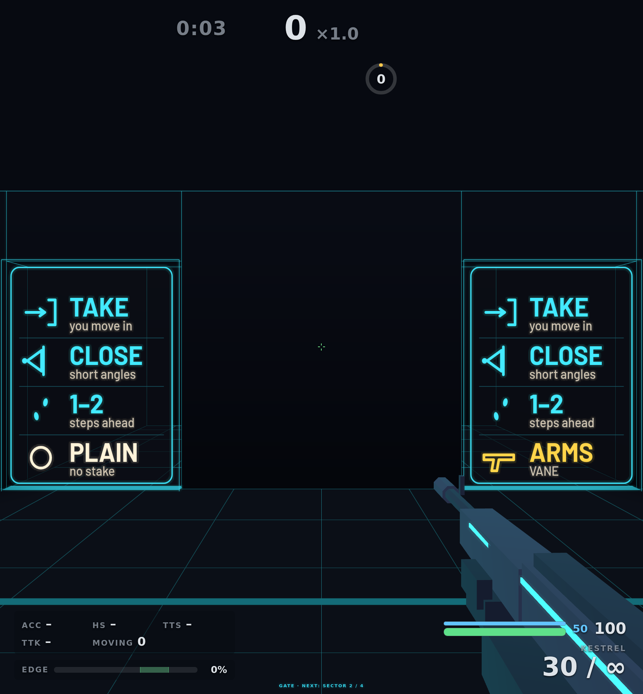

# Vision review 2

Tracking issue: [#243](https://github.com/omkarbhale/flickline/issues/243). Date: 2026-11-15. Reviewed against [`docs/vision.md`](../vision.md). Previous review: [`vision-review-1.md`](vision-review-1.md) (#115).

This is the second critic's pass, and the first since the redesign made Flickline one game you replay, Sweep (vision principle 10, #187, tracked on #188). It has three jobs:

1. check which of review 1's findings are resolved in the running game and which only on paper;
2. judge Sweep against the whole vision: would a person want to play a run again tomorrow, and are the reference game's mechanics exercised inside it in match-like form;
3. find the next problems nobody has asked about, from the side of a reference-game player who sits down with Flickline for twenty minutes a day.

Each finding gives its evidence, why it matters for transfer or fun, and a concrete answer or the experiment that would settle it. Findings are ranked by how much they threaten the vision and grouped by kind:

- **Gap**: nobody has asked about it.
- **Aimed wrong**: it is planned, but the plan would build the wrong thing or build it in the wrong order.
- **Built short**: it exists, but falls short of the vision.

Where a finding is a gap in what the game is for, the answer was decided from the owner's own words, recorded on the issue and marked there as *a call made on the owner's behalf*.

## Method

- **Read:**
  - `docs/vision.md`, `docs/design.md` (v2) and `docs/transfer-checklist.md`;
  - `docs/research/replay-not-drills.md`, `prepared-holders.md` and `survival-rewards.md` in full, and the summaries and decisions of the other research documents;
  - review 1 and human check 1;
  - the full open and closed issue list;
  - the trackers #9, #10, #61, #62, #63, #70, #74, #149, #188 and the open question #110;
  - the balance issues the Sweep work filed on itself: #165, #230, #233, #236, #239, #241.
- **Read in the code**, at `main` `3ab8d87`, and re-checked after #86, #203 and #210 merged (`e6ff27e`; the enemy fire, sight and placement code is unchanged):
  - the run director and its config (`src/modes/sweep*.ts`, `src/config/sweep.ts`);
  - the Echo behaviours and enemy fire (`src/sim/strafer.ts`, `peeker.ts`, `enemyFire.ts`, `enemyTiming.ts`);
  - the sector maps (`src/sim/levels/*.json`) and the results card's cause-line wiring.
- **Played** a production build (`vite build`, `vite preview`) in headless Chromium through `window.__flickline`:
  - seeds 7 and 11: walked the Opener, met a `take-expected` holder and stood in its fire;
  - went through a gate;
  - walked every exit to the results card.

  Two screenshots are in `docs/screenshots/vision-review-2/`; the rest are kept with the task data.
- **Measured** with the bot harness (`npm run bot -- --sweep-report`, 60 runs at each of skills 30, 50 and 70) and with a short bus tap over the same headless game: `HeadlessGame` plus `playMode`, 60–80 seeded runs at skill 50. The tap counted `enemySawPlayer` distances, `shotFired`, `enemyFired` and `contactSettled`. It is a scratch script, not added to the repo; each number below names what it counts.
- **Web:** the reference game's own practice modes, cited in finding 2.

What `main` is today: **Play** starts a Sweep run of four take or meet sectors on Elbow and Lane. Health and shield carry over and death ends the run. Each gate has two doors with true facts and a stake. Sectors carry eco and light conditions, the player picks a primary, and there are the Daily Route, run and situation records, contact settles and the run results card. Not built yet: hold sectors and the Finale (#204), Overtime (#206), tempo (#100), the full scenario sampler (#97), the enemy mind beyond its timing distributions (#87–#96), fight attribution (#120–#125), the cold opener (#209) and Foundry (#36). Skill matching inside the run (#203), the lean (#210) and per-enemy timing distributions (#86) merged while this review was written; every bot number below was re-run on `e6ff27e` after them.

## What is good (said plainly)

- **The redesign is the right answer to the owner's principle, and it shipped fast.** Play starts a run within one click, the drills are off the menu, and nothing in the loop asks for a routine. Within days the project went from seven drills to a playable run with routes, conditions and a daily seed.
- **Carried health with run-ending death gives every fight a stake.** That is closer to the reference game's one life per round than any drill could be, and it is what makes the Overtime bank-or-push decision real.
- **Take sectors place enemies before sight.** Lines of sight open because the player moves (#201). Review 1's finding 7 (arming by floor marks) is resolved in play, not only in the design.
- **Armour and economy are right on `main`.** Both sides use spec shields, and eco and light sectors change the bullet counts honestly (#131, #207).
- **Door facts are true by construction** (`sweepGate.ts`). The gate never lies, which is what makes it learnable once it varies (finding 8).
- **The project now criticises itself.** The Sweep builders filed their own balance findings with bot evidence: #230, #236, #239, #241. #239 in particular is exactly the kind of "the decision is not a decision yet" finding a review should catch.
- **The prepared-holder study is exemplary.** `prepared-holders.md` answers #127 with a seeded, 4,000-duel experiment, a sensitivity table and a clear criterion, and the timing rule is built into `enemyTiming.ts`.

## Review 1: resolved in play, or only on paper

| # | Review 1 finding | Status on `main` | Verdict |
|---|---|---|---|
| 1 | Floors let the player out-react prepared holders (#127) | Split floors are built into `enemyShotTiming`, and a prepared holder's tell no longer delays its shot. But its shot is still a dice roll, and its sight is a single eye ray (finding 1), so the duel's outcome is not the one the study modelled. #127 stays open for #90/#91. | **Timing resolved; the duel is not** |
| 2 | Nothing measures transfer; warm-up looks like learning (#128) | The cold-opener library merged (#190), but the cold opener (#209), its trend (#151, #153) and the check-in (#154) are open. The only progress number shown is the in-session Line rating, and a run with no shots still moves it (#233: 1200 → 651 on my first run, which had no fights). | **Paper** |
| 3 | Cues on every trial, never fading (#129) | Built (#166): per-skill phases, the tell-cue dial axis and the clean opener. The retention experiment (#164) is open. | **Resolved in play** |
| 4 | Research numbers never adopted (#130) | Adopted (#156). | **Resolved** |
| 5 | No armour (#131) | Built: heavy shield by default, eco and light sectors, the armour note. | **Resolved in play** |
| 6 | Rewards pay only for kills and speed (#132) | Contact settle and isolated chains built (#169). But the ranking was checked on the contact model, not the real run. And the route layer brought the bias back: always-Hot out-scores reading the gate (#239, finding 6). | **Contact level resolved; route level regressed** |
| 7 | Corner Clear arming by floor marks | Take sectors place Echoes out of sight before entry. The "angles exposed at once" and "clearing order" stats were never built. | **Resolved in play, stats missing** |
| 8 | No elevation (#133) | Step-up and ramps are built and linted. Every hold anchor in Elbow and Lane is at floor height, and the one raised peek sits in the sector that rarely produces a fight (#230). | **Code resolved; absent from play** (finding 4) |
| 9 | "Human-like" calibrated against Flickline players | Scope comments posted on #95 and #96. Nothing built, nothing changed. | **Open** |
| 10 | Spotting is a pop-out task (#134) | Unchanged, and slightly worse: a `take-expected` holder stands whole-body in the open (screenshot below). | **Open** |

## Ranked findings

| Rank | Finding | Kind | Action |
|---|---|---|---|
| 1 | Echoes on `main` hear nothing, see only the player's eye from any side, and hit by a dice roll that ignores cover; the enemy mind waits behind the game layers | Built short | [#247](https://github.com/omkarbhale/flickline/issues/247); order change on [#188](https://github.com/omkarbhale/flickline/issues/188) |
| 2 | Sweep gives about half the fights a minute of the reference game's own deathmatch, and nothing measures it | Gap | [#248](https://github.com/omkarbhale/flickline/issues/248) (call made on the owner's behalf) |
| 3 | Every fight is now situational, and none says why it was lost: attribution is outside the v2 order | Aimed wrong | Comment on [#110](https://github.com/omkarbhale/flickline/issues/110); order change on [#188](https://github.com/omkarbhale/flickline/issues/188) |
| 4 | Fights are close, full-body and level: first sight median 7.9 m, no sector sightline past 17 m, every holder on the floor | Built short | [#249](https://github.com/omkarbhale/flickline/issues/249) |
| 5 | Taking damage and slow-on-hit barely happen: about 1.5 hits taken per run | Built short | Scope comment on [#165](https://github.com/omkarbhale/flickline/issues/165) |
| 6 | The transfer habit review has never run; four game-layer habits on `main` look harmful | Gap | Preliminary review on [#160](https://github.com/omkarbhale/flickline/issues/160); comment on [#239](https://github.com/omkarbhale/flickline/issues/239) |
| 7 | Nothing can tell whether anyone replays: no person has played Sweep, and the save keeps no record of sessions | Gap | [#251](https://github.com/omkarbhale/flickline/issues/251) (call made on the owner's behalf); comment on [#214](https://github.com/omkarbhale/flickline/issues/214) |
| 8 | Run-to-run variety is three or four sectors, and the two doors usually show the same facts | Built short | Comment on [#239](https://github.com/omkarbhale/flickline/issues/239); #36, #230, #236 |

---

## Built but falling short

### 1. Echoes on `main` are not the enemy the vision describes

**Evidence** (`src/sim/enemyFire.ts`, `strafer.ts`, `peeker.ts`):

| A reference-game opponent | An Echo on `main` |
|---|---|
| Hears you run, land and reload | Hears nothing: no code path feeds the player's `footstep` events to an Echo. The player does hear Echo footsteps (`enemyFootstep`), so the "symmetric radii" of design §4.4 are one-sided. |
| Sees what is in front of it, and sees a shoulder before an eye | Sees the player when one ray from its muzzle to the player's **eye** is clear, within 80 m, **in any direction**. There is no facing and no attention cone; `unaware` only adds an orientation delay. |
| Aims, and hits what the crosshair is on | Rolls a hit chance (dial base × distance falloff, ×0.5 if the player is moving), then rolls the zone: 12% head, 78% body, 10% legs. Cover is not consulted, so a player showing only a head over half cover can be hit "in the body". |
| Re-peeks, repositions, trades, pushes, follows | Strafes on a fixed lane or loops a peek pattern on its anchor. Survivors of a skipped take sector do not follow (design §4.2 says they do). |

Design §5.3 says Echo shots are "aimed, not rolled ... with no hidden hit roll", and the vision's *Currently* line for principle 6 says Echoes "run on the player's movement and weapon code". Neither is true on `main`. Of the enemy-mind backlog (#86–#96), only #86 (per-enemy random streams and human timing distributions) and the prepared-holder timing rule (#127) have landed; perception, aim, decisions and the shared body (#87–#92) are open. The v2 build order lists it as a "parallel track", while the redesign calls it "the main source of run-to-run variety" (design §2.4, comment on #70). The gates, conditions, Daily Route, records and the lean were all built first.

**Why it matters.**
- **Transfer.** Each gap teaches a habit the reference game punishes:
  - Running everywhere is free.
  - Exposing less does not reduce what can hit you.
  - A jiggle never draws a shot, and the leading shoulder is invisible to the Echo: the 30–45 ms that `prepared-holders.md` §3.2 says perception would restore.
  - The angle you just lost on is always where the enemy still is.
- **Principles 6 and 7.** Every card on `main` is the same mind with different starting timers. The owner's two founding questions (enemies that act like players, and fights whose information varies) are answered in the research and the plan, not yet in play.
- **Replay.** Systemic variety (design §1, pillar 2) rests on minds that differ. Without them, run 20 plays like run 1 with a different corridor.

**Proposed answer** ([#247](https://github.com/omkarbhale/flickline/issues/247)): build the part of #89 and #90 that the fights need before more game layers:
1. hearing on the same radii the player hears by;
2. sight with a facing and upper-body sample points;
3. aimed shots resolved against the player's real hit zones and the level's boxes, with the dial setting aim error, not a hit chance;
4. #91's minimum: re-peek or move after a duel, and survivors who follow.

Re-run S12 with real perception there, and decide peeker's advantage (#127) on that result. The order change is posted on #188.

### 4. Fights are close, full-body and level

**Evidence.**
- **Distance.** 230 first sightings over 60 runs at skill 50: 10th percentile 5.0 m, quartiles 5.7 / 7.9 / 9.4 m, 90th percentile 18.8 m.
- **Ceiling.** `npm run map-lint` reports that no sector's longest sightline exceeds 17.3 m, so the "long angles" of design §10 (22–26 m, up to 45 m) cannot occur.
- **The dial's distance axis is unused.** Design §9.4 maps the dial to Echo distance (5 → 35 m); `modes/sweep*.ts` never reads a distance.
- **Level.** Every hold anchor is at floor height.
- **Full body.** A `take-expected` holder is a Strafer standing in the open on its anchor. Above, it is first seen as a whole body, 4 m away, centred in the corridor. Partial exposure exists only for the `clear` card's Peekers.

**Why it matters.**
- At 5–9 m a standing head spans 2–3°. Crosshair placement, first-bullet discipline, tapping against bursting, and range-based weapon choice are barely tested. "Spray at whatever appears" works here and fails at 20 m.
- Crosshair placement across height, the real part of review 1's finding 8, is possible in the code and absent from play.
- Bright, close, full-body targets make the pop-out problem (#134) worse.

**Proposed answer** ([#249](https://github.com/omkarbhale/flickline/issues/249)):
- placement draws by distance band as well as card;
- every sector map gets long, raised and low anchors, and holders that hold from cover;
- the lint checks the bands;
- the bot report prints the first-sight distribution;
- target (HYPOTHESIS): a median of 12–15 m and 20% of fights beyond 20 m, settled against reference-genre data rather than Flickline players (review 1, finding 9).

### 5. Taking damage and slow-on-hit barely happen

**Evidence.**
- Over 60 runs at skill 50, Echoes fire 5.5 shots per run and hit 27% of them: **about 1.5 hits taken per run**, so under a second spent tagged.
- Mean health+shield at the four sector exits: 150 → 137 → 124 → 119.
- #239 found 88% of gates reached at full health and full shield, and deaths coming from one lethal fight rather than wear.
- In the browser I stood still in the open for a full second, 4 m from a `take-expected` holder at the Opener's dial; its burst missed.
- #165, filed from the contact model, says the opposite (contacts far too deadly). The built run contradicts the model.

**Why it matters.**
- The owner named "taking damage" and "slowdown-on-hit" among the mechanics Flickline must match. Fighting while tagged (re-aiming through flinch, choosing to stop or to strafe out while slowed) is learned only by being hit.
- Health is also the stake that makes the doors, the settle and Overtime decisions.
- The design's two targets do not fit together as written. A 70% contact win target (§9.3) and a Finale reached in about half of runs (§4.1) imply a death rate of about 6% per contact over 10–12 contacts (0.94¹¹ ≈ 0.5). So most lost contacts must be hurt clears or resets, not deaths, and the design never says so. Today the bot dies in about 10% of contacts, and when it survives it is almost never hurt.

**Proposed answer** (scope comment on [#165](https://github.com/omkarbhale/flickline/issues/165)):
- widen #165 to "lethality and attrition in the real run";
- report hits taken per contact, seconds tagged per run, and the share of contacts finished hurt;
- target a matched player finishing about half of contacts hurt while still clearing about 70%, with health falling as a gradient over the run;
- tune by Echo aim error once #247 makes shots aimed.

### 8. Run-to-run variety is three or four sectors, and the doors usually agree

**Evidence.**
- The catalog is Elbow's three take sectors and Lane's meet. One of the Elbow sectors rarely produces a fight (#230), and Lane's take sector cannot hide an Echo (#230).
- A run deals 3.6 contacts from four take cards and `meet`.
- Every Elbow sector's longest sightline is 15–17 m, so doors almost always read `close`, and most read `1–2` heard.
- At the gate above, both doors showed the same role, sightline and sound, and differed only by stake.

**Why it matters.**
- Principle 10's "choices that matter" needs facts that differ. Reading a gate cannot be learned while the facts rarely vary.
- With the stake as the only difference, the always-Hot policy that #239 found dominant is the whole decision.

**Proposed answer** (comment on [#239](https://github.com/omkarbhale/flickline/issues/239)):
- more sectors, through #36, #230, #236 and #249;
- doors drawn so their facts differ in role, sightline or sound whenever the catalog allows;
- #239's own target: the policy that reads the gate out-scores always-Hot, as a CI check like #132's.

---

## Planned but aimed wrong

### 3. Every fight is situational now, and none says why it was lost

**Evidence.**
- Under v1 most play was drills, where an outcome is almost purely mechanical. Since #187 every fight is a Sweep contact drawn from a card: exactly the noisy fights the owner's question #110 says need attribution.
- On `main` the results card has a slot for the death cause line (#123), but nothing fills it except a debug stub (`features/results.ts`).
- The fight ledger, par and engine, and cause lines (#120, #121, #123) are open.
- The one thing to fix is the #26 stub, which says "Nothing stood out" in about 80% of bot runs (#241).
- The v2 build order gives attribution no step: it is a "parallel track", while every game layer was built first.

**Why it matters.** Principle 3 is how Flickline claims to beat the reference game as practice: the player learns what worked and what to fix while the moment is fresh. In situational fights per-shot cues are not enough. A death to a prepared crossfire, read as "my aim is bad", teaches the wrong lesson. The redesign made the fights the owner worried about the whole game, and left the answer to their worry for later.

**Proposed answer** (comments on [#110](https://github.com/omkarbhale/flickline/issues/110) and [#188](https://github.com/omkarbhale/flickline/issues/188)):
- put #120 → #121 → #123 into the v2 order before the repeat-enjoyment playtest (#214);
- #124 and the full fix engine (#39) follow;
- a playtest of situational fights without the cause line would judge a feedback loop missing half its design.

---

## Gaps nobody has asked about

### 2. Sweep gives about half the fights a minute of the reference game's own deathmatch

**Evidence.**
- **The bar.** The research says reference-game players already practise in deathmatch "because enemies shoot back" (`replay-not-drills.md`, finding 7). The vision promises improvement *faster than playing it*, so deathmatch is the bar.
  - Free-for-all deathmatch: first to 40 kills, 9-minute cap ([Riot support](https://support.riotgames.com/en-us/valorant/gameplay/valorant-game-mode-ffa-deathmatch)).
  - Team deathmatch: first to 100 kills in 9:30, with a 1.5 s respawn ([Riot, Team Deathmatch 101](https://playvalorant.com/en-us/news/game-updates/valorant-team-deathmatch-101/)).
  - A player who goes even in either mode fights about **4 times a minute** (DERIVED).
- **Sweep as designed:** 10–14 contacts in a 5–9 minute run, about **1.5–2.5 a minute** (DERIVED from design §2.2, §2.3 and §4.1).
- **Sweep on `main`:** 3.6 contacts dealt per run, 3.0–3.1 fought, and **4.4 shots** fired by the bot. #241 found a run too thin for the fix engine's 8-shot minimum.
- No design section, fun criterion or bot report states a fight rate or measures dead air.

**Why it matters.**
- **Volume.** Motor learning needs repetitions. Flickline's per-fight quality has to outweigh a 2–3× deficit in volume before the promise can hold, and nothing checks that it does.
- **Pace.** "Fast, instantly rewarding fights" and "drops the reference game's slow pace" are the vision's own words. Walking between rare fights is slow pace by another route.
- **The warm-up player.** Someone who opens Flickline for twenty minutes before ranked wants volume. A dozen fights per run will send them back to deathmatch.
- **Per-run systems starve.** The fix engine, the lean, per-skill trials and the cold opener's noise all depend on the number of fights in a run.

**Proposed answer** ([#248](https://github.com/omkarbhale/flickline/issues/248)). *Call made on the owner's behalf:* Sweep must not deliver fewer fights per minute than the reference game's deathmatch. Situational richness is how Flickline wins per fight, not a licence for fewer fights. In practice:
- measure fights per live minute and dead air in the bot report (also with a human-pace walker) and in the fun criteria (#66);
- target about 4 contacts a minute, no dead air over about 15 s inside a sector, and gates of about 5 s (HYPOTHESIS until #214);
- levers: tighter sector entries and exits, more contacts per sector, hold sectors' arrivals, Echoes that come to the player, shorter gates;
- re-check #132 and #239 at the new density.

### 6. The transfer habit review has never run, and the game layers shipped without it

**Evidence.**
- #160, the first habit review, was re-scoped to "the first playable run" by #187.
- Since then #201, #202, #205, #207, #208, #212 and #217 merged, and #149 still reads "Latest verdict: none yet".
- `docs/transfer-checklist.md` added item T14 (game layers) for exactly these layers.

A preliminary pass from the code and play, posted on [#160](https://github.com/omkarbhale/flickline/issues/160), scores four situations *harmful*:
- **Running everywhere** (T12, T14): Echoes are deaf (finding 1).
- **Exposing less does not help** (T4, T11): hits and zones are rolled without cover.
- **Re-peeking the angle you lost on is always right** (T11): Echoes never move.
- **Always take the Hot door** (T10, T14): #239. This is the over-aggression #132 removed per contact, back at the route level.

Kill-heal ("fight to heal at low HP") is marked *to measure*. Shields and conditions, the contact settle, and the clean opener score *same*.

**Why it matters.** The vision calls a situation or reward that builds a habit that fails in the reference game "a bug, however fun". The transfer track exists so that such habits are caught before they ship, and on `main` none was looked at.

**Proposed answer.**
- Run #160 as soon as #247 lands.
- Make "habit review of the new game layer posted" part of the acceptance of every future game-layer issue, as T14 intends.
- Treat always-Hot as a transfer defect with a CI guard like #132's (comment on #239).

### 7. Nothing can tell whether anyone replays

**Evidence.**
- No person has played Sweep. Human check 1 records that the owner chose to keep building over pausing for a feel check, and #180 is open. Every fun verdict so far is an agent's, and an agent replays whatever it is told to.
- Flickline rightly sends nothing anywhere.
- The save keeps run summaries, but not when the runs were played, how sessions ended, or whether a run was started straight after a death.
- The repeat-enjoyment playtest (#214) asks testers to report day-3 and day-7 return from memory.

**Why it matters.** Principle 10 is the newest and most demanding promise: repeat enjoyment, not one-time enjoyment. As things stand it has no measurement that could ever fail.

**Proposed answer** ([#251](https://github.com/omkarbhale/flickline/issues/251)). *Call made on the owner's behalf:* repeat enjoyment is measured from real play, locally, and the player owns the record. A **play journal** in the save records:
- sessions, runs started and finished, and how each session ended;
- runs started within 10 s of the results card;
- the days the player came back.

The profile shows it in one line, the export file includes it, and testers paste their export into #214. It is never a reward or a streak. A comment on #214 also asks that hypothesis R3 ("variety keeps run 20 fresh") not be judged *not supported* on today's three-sector catalog.

---

## Would a person replay Sweep? A verdict on `main`

**Not yet, and the reason is not the frame.** The frame is right:
- carried health and run-ending death;
- doors with true facts;
- conditions that change bullet counts;
- a daily seed;
- records that compare like with like.

What a run on `main` lacks is the content that frame was built to carry:
- four sectors from about three usable ones;
- 3–4 fights and a handful of shots;
- Echoes with one mind;
- close, level, full-body targets;
- being shot only rarely;
- doors that usually agree;
- no answer to "why did I lose that one".

A player who plays three runs today will have seen most of what Sweep has. The game layer has not diluted the reference game's mechanics by changing them: the numbers are the spec's. It has diluted them by being built first. Movement, perception, being hit, range and height all reach the player in their easiest form, and only rarely.

The fix is an order, not a redesign. The proposed order, posted on #188:

1. Echo hearing, facing and aimed shots (#247).
2. The fight cause line (#120 → #121 → #123).
3. Hold sectors (#204), with range, height and cover (#249, #36).
4. Fight density and attrition, measured (#248, #165).
5. Then the repeat-enjoyment playtest (#214) with the play journal (#251).

## What would make Flickline fail even if every issue were built

- **Echoes calibrated to Flickline players** (review 1, finding 9). Still open, and it becomes the largest risk once #247 makes the mind real: a mind tuned to Flickline testers converges on Flickline's habits. The cheapest anchor remains public reference-genre demo data.
- **Visual detection.** Bright Echoes on a dark, empty scene (#134) mean time to shot measures a task the real game does not set. Finding 4 makes it a little worse.
- **Volume.** If finding 2 is answered by making runs longer rather than denser, Flickline stays a slower way to practise than deathmatch, whatever its feedback.

## Smaller observations (no new issue unless noted)

- **"Route cleared" on an empty run.** A run in which nothing was fought ends "MADE IT OUT · ROUTE CLEARED, 4 SECTORS". Filed as [#252](https://github.com/omkarbhale/flickline/issues/252); #233 covers the rating drop on the same run.
- **The design describes the target as if built.** Design §5.3 says "aimed, not rolled", and the vision's principle-6 *Currently* line says "the player's movement and weapon code". Both describe the plan. Suggested on #188: a "built on `main`" column in design §17, so a review can tell paper from play without reading the code.
- **Reserve ammo is infinite in runs** (`30 / ∞`). Magazines and reloads are real, so this is harmless to transfer today; note it if ammo economy is ever wanted as a stake.
- **The run clock** shows at the top centre, although nothing pays for time. Watch in #214 whether it pushes players to rush.
- **The bot's matched win rate is 82–88%** at skills 30, 50 and 70 (`--sweep-report`), above the 70% target. This is expected while the Opener is −8 and Echoes rarely hit (finding 5); recheck after #247.

## Considered and not filed

- **Teammates and trades.** Most reference-game fights involve a teammate's information or a trade, and Flickline's player is always alone. The vision is explicit ("Not multiplayer: you play alone against Flickline's enemies"). *Call made on the owner's behalf:* no AI teammates. The information a teammate gives is covered by the callout stand-in (#99), and trades are practised from the other side, as Echoes trading each other (#92).
- **Kill-heal as a harmful habit.** Plausible ("take a fight to heal"), but the heal is small (5 or 10 HP) and the settle prices health. It is left to the habit review's measurement (#160) rather than filed on a guess.
- **Peeker's advantage.** Left to the S12 re-run with real perception (#247, #127), as `prepared-holders.md` §3.2 decided.

## What to check first when a human plays it

Only a person with a mouse, headphones and the reference game can judge these. Do them in this order, in three runs and then again the next day (#180, #214).

1. **Did you want a fourth run, and did you come back the next day without being asked?** Write down the answer before anything else (#251).
2. **Enough fighting?** Count the fights in a run and notice the walking between them. Is this faster practice than a deathmatch? (#248)
3. **Run everywhere, then walk everywhere.** Does anything change? Did an Echo ever react to your footsteps? (#247)
4. **Shoulder-peek and jiggle a holder.** Does it ever shoot at your shoulder? Do you ever feel the holder saw you first? (#247, #127)
5. **When you died, did you know why?** Say it in one sentence, then compare with what the replay of the seed shows (#110).
6. **Get hit on purpose.** Does slow-on-hit feel like the reference game? Could you tell where the shot came from? How often were you hit at all in a run? (#165)
7. **Range and height.** Did any fight feel like a long-range duel? Did you ever tap or burst instead of spraying, or aim up or down at someone? (#249)
8. **At the gates.** Did the doors' facts ever change your pick, or did you always take Hot? (#239)
9. **Spotting.** Do Echoes pop out more easily than enemies in the reference game, and by how much? (#134)
10. **Still open from review 1:** sensitivity (a 360° in the same mouse distance), the counter-strafe stop feel, and input latency at your refresh rate. These are the first three items of #180, and nobody has checked them yet.
